# Digging-in-Digital-Garbage

 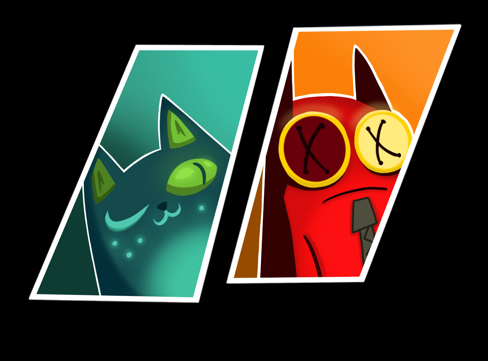
## ATTENTION
This post is very long. Since "Digging in Digital Garbage" is something like a study of very old developer accounts on DeviantArt. The links were initially discovered through footnotes on the wiki page dedicated to [Nemlei](https://coffin-of-andy-and-leyley.fandom.com/wiki/Nemlei). Initially I was driven by an attempt to learn at least something about the developers exclusively for myself. But, having followed these links on the page, I expected to see at best one or two preserved messages. However, having followed them, I discovered what seemed to me the informational equivalent of El Dorado.

And then two questions arose before me. The first — "has anyone studied it?" — and the second — "how well-known is the information from them?". Having searched the internet, I was able to find answers to my questions. However, they did not satisfy me. Yes, they studied it, but superficially and biasedly. And after searching the internet and talking with fans of the game (not on Reddit, but in other places), I received confirmation. They confirmed that no one had done anything like this before me.

Therefore I decided to write it. Its active writing period took about two months. I wrote it in my free time from work and studies. However, the work was rewritten, and blocks of information were regularly rewritten or deleted. Sometimes because I considered this information unnecessary or unrelated to Nemlei's formation. Sometimes because at one moment I found the second account of Nemlei's husband, and the information could not be ignored.

Then, already at the final stage of writing the work, I began to think about where such material could be posted. In the end I came to the conclusion that Reddit is the most suitable platform for this kind of work.

I will also separately clarify a couple of things. I know English at an insufficient level to write something like this in it. This text was translated into English by a neural network, but the text was checked for errors and inaccuracies by another person. (But still, if you find inaccuracies or strange turns of phrase, report it in the comments.)

## bignored.
Then, already at the final stage of writing the work, I began to think about where such material could be posted. In the end I came to the conclusion that Reddit is the most suitable platform for this kind of work.
I will also separately clarify a couple of things. I know English at an insufficient level to write something like this in it. This text was translated into English by a neural network, but the text was checked for errors and inaccuracies by another person. (But still, if you find inaccuracies or strange turns of phrase, report it in the comments.)

## Introduction
This work is dedicated not so much to the game itself, but to summarizing known information about the developers and introducing to the community's discussion completely new sources of inform ation that had previously eluded the attention of the gaming community, where, as it turned out, a lot of useful data is concentrated, which my work is intended to organize, as well as conclusions based on this data concerning exclusively The Coffin of Andy and Leyley (TCOAAL). Therefore, if you want to know how Nemlei and her husband met, what their names are, how they live, who fucks whom, and what they think about the SVO and other things unrelated to the game, then this is not the place for you. I am interested primarily in Nemlei's creative path — her personality, her evolution as an artist and writer, and how this was reflected in TCOAAL. The personality of her husband (Avencherus) is considered as additional context — insofar as the surviving sources allow, which, unfortunately, are fragmentary.

## Chapter 1. Background
The demo version of The Coffin of Andy and Leyley was released on [Itch.io](https://itch.io/) and Steam on March 25, 2023. With the release of the second episode on October 13, the center of the community moved to Steam under pressure from external circumstances. Due to the theme of incest and Satanism, the game caused a scandal in the media and radical internet circles. More specifically, American neo-Nazis (I will not write their specific name and location because I do not want to popularize them even in a negative way) accused the developer of promoting Satanism and incest, starting a doxx, finding her old accounts on DeviantArt, and through them — her husband's accounts on the same DeviantArt and other social networks. In response, the developers deleted all accounts and social networks, going into hiding, explaining this in the devlog "Devlog 07" dated December 10 by the desire to focus on the game. However, the developers' accounts were preserved in the Wayback Machine, but, unfortunately, far from fully. It is they that will become the basis and main sources.

## Chapter 2. Sources
The basis of the entire work is primarily the old accounts of Nemlei and her husband on DeviantArt, found by doxxers back in 2023, after which they were deleted by the developers, but partially preserved in the Wayback Machine. And here some may have a question: doesn't this fall under the concept of doxxing? No, this is not doxxing, since these accounts fall under the definition of public activity under EU laws. DeviantArt is not YouTube or X, but a platform for artists' self-expression, where accounts represent a public gallery. You can publish something there only after registration, which Nemlei and Avencherus actively did. Moreover, they were members of various communities and even organized events, and Nemlei even gave interviews. By the standards of the platform of those years, they had solid reach: 1500 followers for Nemlei and 900 for Avencherus. In the same way, on other accounts they continued to actively share their creativity, and in 2018 they kept a developer diary on the platform. Thus, their accounts are not the same as your Steam or YouTube account.

However, this does not mean that the publicity of accounts justifies doxxing. Public activity does not give anyone the right to collect and distribute personal data, threaten developers, or harass them. I believe that the doxxers acted illegally and immorally, and their actions have nothing to do with this research. My work uses exclusively the materials that the developers themselves published for a wide audience. My work does not aim to reveal their identity or cause harm. I analyze creativity, not hunt for people's personal data.

Now it is worth talking about relevance, since these pages were kept more than ten years ago, but it is worth clarifying that Nemlei's accounts were kept in the period starting from age 18 and approximately until 25, that is, they cover the period when the foundations of worldview are already formed and consolidated. Yes, undoubtedly, during this period the personality still undergoes changes, but a complete rearrangement of values, as a rule, does not occur, and this is exactly the case when it does not occur. Avencherus's accounts, however, were kept by him already at a fully conscious age.

The sources used in the work, as already mentioned, are 4 accounts on DeviantArt, which the developers kept from 2010 to 2018. 

Nemlei's accounts were called:

* [ruismandariini](https://web.archive.org/web/20120529110241/http:/ruismandariini.deviantart.com/) (translated as "Rye Mandarin"). One was kept from 2010 to 2014, but only the period from 2010 to 2012 was preserved. 
* [kattiapina](https://web.archive.org/web/20151022235741/http:/kattiapina.deviantart.com/) (translated as "Cat Monkey"). It was kept from 2014 to 2018. This account was preserved better than the first: the period from 2015 to 2016 was preserved, and one preserved year — 2018. 

For convenience, I will divide the [kattiapina](https://web.archive.org/web/20151022235741/http:/kattiapina.deviantart.com/) account into two periods. I will call the first period "Yolala", after the developer's first nickname; this period covers 2014 and 2015, and the second, "**Kattiapina**", covers only 2018. Also, in the future, I will sometimes replace the word "**Nemlei**" with "**Kattiapina**" for variety.

The accounts of the second developer, or rather Nemlei's husband, were called:

* [Shisho2k](https://web.archive.org/web/20110324184928/http:/shisho2k.deviantart.com/) (translated from Japanese as "Branch", but pronounced "Sisho"). It was kept from 2008 to approximately 2013, but data after 2011 was not preserved. 
* [Avencherus](https://web.archive.org/web/20150905232045/http:/avencherus.deviantart.com/) was kept from 2014 to 2018. Unfortunately, this account was preserved worse than all: only page data for 2015 and 2016 were preserved. 

Also, from this moment I will call Nemlei's husband "**Avencherus**", occasionally returning to "**Husband**".

The main sources of information from these accounts are comments under paintings (especially on the Yolala account), as well as messages they posted in the "journal" section, especially concerning [Shisho2k](https://web.archive.org/web/20110324184928/http:/shisho2k.deviantart.com/), where there were extremely many posts. But posts on DeviantArt are not all; also, all games released by them before TCOAAL will be used as sources.

Now a few words about why I consider these accounts to truly belong to the developers. The obvious question, so I will give an obvious answer: these accounts were deleted after attempts to find personal data through them, which indicated that they had access to them. As you read, you will also be convinced that they are indeed authentic.

Problems with the sources. First of all, it is connected with the fact that the accounts were preserved in poor condition: for example, on the ruismandariini account, out of eight hundred comments, only about seventy can be viewed; a similar situation on the others. Also, a significant portion of them are simply thanks and wishes of all the best to users who rated their works well, and only a small portion of the remaining comments has practical use. Therefore, sometimes far-reaching conclusions can follow from one or two comments, but I will try to avoid this and provide in support of this or that hypothesis, looking at the games created by them, especially TCOAAL.

## Chapter 3. Kit9studio

This chapter contains information about the history of the studio's appearance, and also includes a story about the first games of this studio, since a story about these games in separate developer chapters disrupted the narrative, but it is also impossible not to mention or mention in passing, because without a story about these games separately, one of the most important themes of the work will not be clear — why the developers went into total isolation.

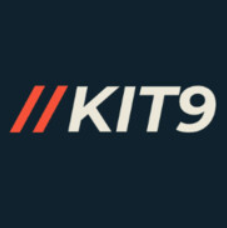
The studio's current logo

To begin with, it is worth discussing what lies on the surface. The structure and what Kit9studio actually is. If you try to search for information about them online or go to the studio's website indicated on the main page in Steam, a strangeness is discovered. The only game in their portfolio is The Coffin of Andy and Leyley". Which looks very strange, given the information about the sale of rights to develop it. Did Kattiapina entrust development to beginners? Although she herself had created and released six games before, does she consider herself less experienced than beginners, and looking at the pace of TCOAAL development, only beginners can explain it, just as the absence of information about their activities before TCOAAL, and at this stage the investigation reaches a dead end, coming to the conclusion that Kit9studio is a team of beginners, maybe acquaintances of the developers.

Who, judging by the pace of development and the absence of information about them, apparently never made video games before. But if you go to the [kattiapina](https://web.archive.org/web/20181225154516/https://www.deviantart.com/kattiapina) account for 2018, you can find a link to the [Avencherus](https://web.archive.org/web/20150905232045/http://avencherus.deviantart.com/) account and screenshots of the game Gun-Toting Cats being developed together with him, as well as a link to the [kit9studio](https://web.archive.org/web/20181225154516/https://www.deviantart.com/users/outgoing?https://www.kit9studio.com/) website, and here a suggestion is born that this studio is a joint venture of Kattiapina and Avencherus, remember this and move on.

If you try to search for information about Gun-Toting Cats, then in addition to the game itself, you can find various pages dedicated to <a href="https://web.archive.org/web/20181225154516/https://www.deviantart.com/users/outgoing?https://www.kit9studio.com/">kit9studio</a>, for example, on our Russian website "Igromania" the studio has a <a href="https://www.igromania.ru/company/40705/kit9-studio/">page</a>, from which you can learn about the previously forgotten Kit9studio game "All I Wanted Was a Bouncy Ball", released on November 8, 2019; we will talk about the early games in more detail in another section.

If you try to search for information about Gun-Toting Cats, then in addition to the game itself, you can find various pages dedicated to <a href="https://web.archive.org/web/20181225154516/https://www.deviantart.com/users/outgoing?https://www.kit9studio.com/">kit9studio</a>.

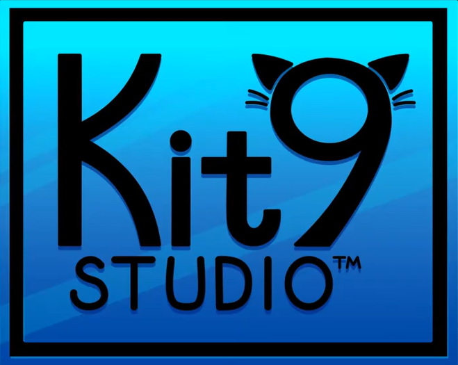
The first studio logo

For example, on our Russian website "Igromania" the studio has a [page](https://www.igromania.ru/company/40705/kit9-studio/), from which you can learn about the previously forgotten Kit9studio game "All I Wanted Was a Bouncy Ball", released on November 8, 2019; we will talk about the early games in more detail in another section.

For now, let's turn to the credits of the forgotten game, from which you can learn about the distribution of responsibilities in the studio: in the credits it is written that programming is done by Avencherus, and art and animation by Kattiapina, also known as Nemlei. Most likely, they made Gun-Toting Cats with this composition, probably the same composition worked on all subsequent projects, and the same composition is working on TCOAAL, which explains the slow pace of development, which indicates that the studio still remains a team of two people with minimal involvement of third-party specialists.

Thus, [kit9studio](https://web.archive.org/web/20181225154516/https://www.deviantart.com/users/outgoing?https://www.kit9studio.com/) was created back in 2018 for game development, so in that period the games Gun-Toting Cats and All I Wanted Was a Bouncy Ball were released, but with the release of the first visual novel, the name [kit9studio](https://web.archive.org/web/20181225154516/https://www.deviantart.com/users/outgoing?https://www.kit9studio.com/) disappears, and instead Kattiapina and Avencherus began to call themselves "Nemlei" in connection with the transition to developing visual novels, but after the release of TCOAAL on Steam and the subsequent scandal, Nemlei and Avencherus decided to revive the game studio, while framing this situation as the purchase of the game by a "studio" in order to separate their identities from the game, thus avoiding doxxing. So now we know that the husband, also known as Avencherus, is responsible for the entire technical part, as well as for how the games will ultimately look.

**Gun-Toting Cats** 
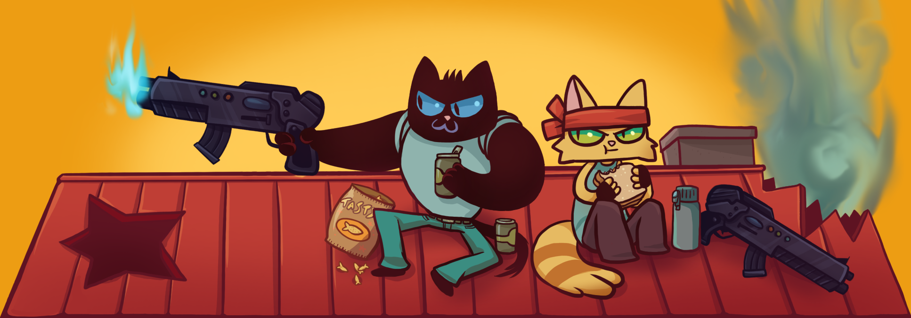

This game, like the next one, is radically different from the others, mainly by betting on gameplay rather than on story, which in these games fits into a couple of sentences, but, however, this does not mean that there is nothing to say about them. Gun-Toting Cats is the first full-fledged game and the first pancake lump at the same time, which Kattiapina and Avencherus approached thoroughly: 

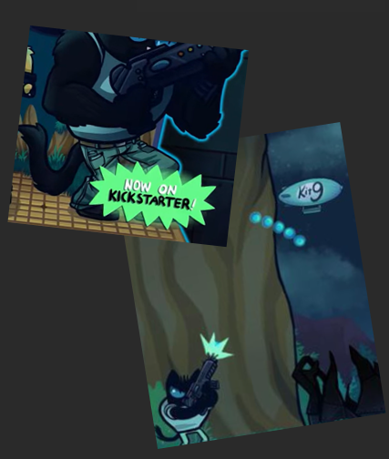
It’s amusing that in the game, you could destroy the airships from Kit9 Studio.

together with the start of development of this game, they founded kit9studio, created its now non-working website, the game itself had its own Twitter page, and on their own accounts they actively shared information about development, even more — the developers began collecting donations on crowdfunding specifically for this game. The developers promised a lot, for example, on Kattiapina's account they promised three locations and five bosses, but for unclear reasons the game's development stopped. What do we have in the end? Gun-Toting Cats is an action platformer very strongly referencing the Contra series, both in gameplay and in the general design of locations. However, except for the pleasant visual style, since all textures were drawn by Nemlei. In terms of gameplay (which prevails in such games), the game is nothing special, except that in the game you can break a bridge if you jump.

On it for a long time. The plot of the game — two unnamed main character cats play checkers (or something like that) with a robocat, the latter loses and, having cursed the heroes, leaves to conquer the world (holy shit, right?) while burning some city, which the main characters see and apparently in the name of saving the world take out guns and go kill all living things (the plot is over).
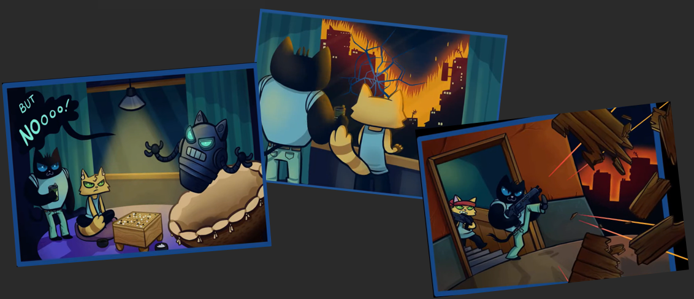
Summing up, most likely, the game's development stopped due to lack of experience in game development, as well as the difficulty of simultaneously running social networks and working on such a large-scale project for beginners. And five full-fledged bosses, or even a second level, never appeared in the game. In principle, that's all that can be said about the game. For those interested, on the internet, thanks to unprecedented luck, there exists a whole one gameplay video, from which I took information for this section: [Gun-Toting Cats - Feline Force](https://www.youtube.com/watch?v=8gca-yU9vr4) (give the guy likes and comments, because he preserved history for us).

**All I Wanted Was a Bouncy Ball** 

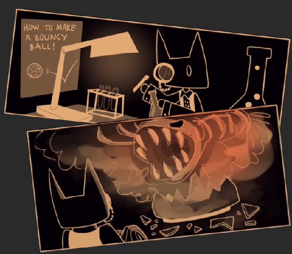
Horror by Nemley

this was the first game made by the studio for the game jam "GitHub Game Off 2019" on the theme "Jumps and Boundaries". Also being an action platformer. The plot is quite simple: the main character, a cat scientist (not the one from Pushkin), wants to create a ball of ideal bounciness, but during another experiment, a failure occurs, and a giant fish skeleton with a purple aura appears and begins to chase us, that's it, the plot is over. 

But then the gameplay began — running from the monster through various levels and collecting upgrades for the main character to run faster, jump higher and more often, and so on until we collect most of the upgrades on all levels, which are chosen in random order in the game, which adds variability to it. Having collected most of the upgrades on the levels, we are let into the final level, where we, having jumped over a giant chasm (if anything, all the game's action takes place in the cat's laboratory), the cat finds a giant flask and brews something, killing the monster with it and leaving only a ball of ideal bounciness from it, and the credits. In which, in addition to their nicknames apparently on Twitter, they also left a link to the Kit9studio website.

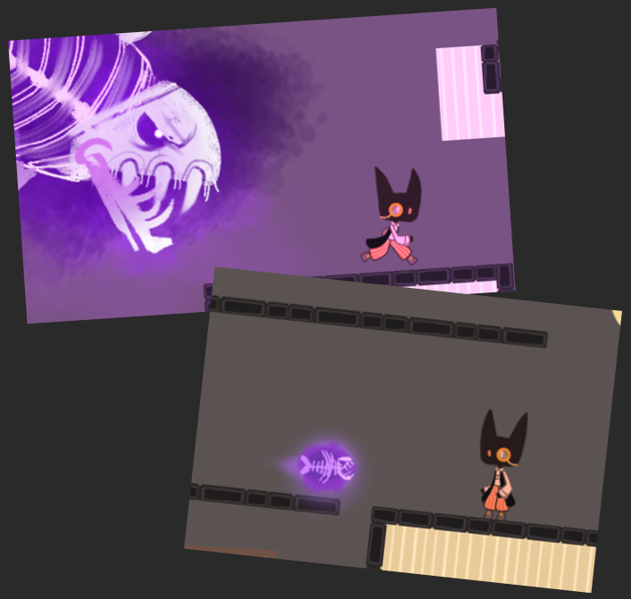
In-game footage

But then the gameplay began — running from the monster through various levels and collecting upgrades for the main character to run faster, jump higher and more often, and so on until we collect most of the upgrades on all levels, which are chosen in random order in the game, which adds variability to it. Having collected most of the upgrades on the levels, we are let into the final level, where we, having jumped over a giant chasm (if anything, all the game's action takes place in the cat's laboratory), the cat finds a giant flask and brews something, killing the monster with it and leaving only a ball of ideal bounciness from it, and the credits. In which, in addition to their nicknames apparently on Twitter, they also left a link to the Kit9studio website.

At Game Off 2019, the game did not take any nominations. Apparently, after this, the developers decided to finally move away from developing games with full-fledged gameplay and switch to creating games where the main emphasis was on plot and lore. The emphasis on this aspect of the game may have been caused by the fact that most of the winners were not only head and shoulders above in terms of gameplay, but also better in terms of plot. Here for comparison is the plot of the game that took first place — Sealed Bite. The main heroine Emilia's relatives begin to disappear one after another, and in desperate search for her loved ones, Emilia encounters an ancient wolf spirit. He offers her power in exchange for following his orders. From this moment, the heroine faces the question: does this power really belong to her, or is the spirit manipulating her, gradually subjugating her will. Agree, one setup sounds stronger than the entire plot of All I Wanted Was a Bouncy Ball.

**Conclusion**
Overall, in my opinion, the main difference between the first years of the studio's existence and subsequent ones is the positioning of the developers: at this time, the developers had all sorts of social networks, exactly the same maximally open approach was to games, their first game had its own Twitter and Kickstarter page. With the second game, everything was much more modest, but they still indicated themselves specifically in the credits, but already in the first visual novel, released in the same year, they already labeled themselves "Nemlei", just as at the same moment they stopped any activity both on DeviantArt and on Twitter, and on the developer page on [itch.io](https://web.archive.org/web/20190716192015/https:/nemlei.itch.io/) they began to label themselves simply as "Nemlei", on the account on the [itch.io](https://web.archive.org/web/20190716192015/https:/nemlei.itch.io/) website you are greeted with this text:

> "A professional seeming introduction text, that informs the reader I make visual novels all by myself, and that these novels tend to include comedy, drama and boys kissing."
> 
> ♪~ ᕕ(ᐛ)ᕗ

And that's it, and also a link to an empty Twitter account, and here the question arises: what made these people, being completely conscious? After all, both were over 25 years old at the time of these events. What made them so drastically change their positioning tactics to the exact opposite? Did they realize they couldn't handle both working on games and maintaining an active online presence? Or were they harassed so much that they decided to cut ties with everything? And why in the account description does clearly Nemlei write that she works alone? Maybe disagreements arose between them, as a result of which the company Kit9studio fell apart? One could speculate for a long time about what happened. But the conclusion from this demagogy can only be one — we need to dig further.

# Chapter 4. Nemlei
This chapter will focus on Nemlei herself and the facts that became known as a result of studying the DeviantArt accounts. I repeat, the developers themselves do not interest me per se, I am interested in their personalities strictly in the context of the game and nothing else. The narrative will be built on the principle of ascent from obvious facts to not so obvious ones, in other words, the narrative will be built on the principle of an iceberg, but in the chapter with Nemlei, that with the help of information from these accounts I will periodically dispel myths that Nemlei has become overgrown with over the years, at the end of each level I will summarize and based on the stated facts put forward my theories regarding the game and characters. Each developer account will not be analyzed separately; instead, information will be presented in a unified form in chapters dedicated to one of the two developers. Each fact will be supported by a corresponding link to a comment confirming this or that assumption, sometimes links to journal entries of Nemlei and Avencherus.
Now that the necessary digression from the topic is over, we can proceed to what you opened and read all this for (or just skimmed through to these lines). If you really did that, I recommend stopping right now and at least briefly re-reading the previous chapters, because otherwise you might miss many important things. And did I bust my ass writing this for nothing?

**Nemlei and society** If you go to the account and go to the comments on the main page or comments under the paintings, she replies to every comment everywhere, in general she often corresponds with someone [Looki look](https://web.archive.org/web/20120313023809/http:/ruismandariini.deviantart.com/art/Looki-look-262710287) and [I ain't stuck](https://web.archive.org/web/20120327113200/http:/ruismandariini.deviantart.com/art/I-ain-t-stuck-258507287), and sometimes even very liberated, like here [re-crap](https://web.archive.org/web/20120411145024/http:/ruismandariini.deviantart.com/art/re-crap-257060093), what can I say, they did a whole interview with her "[Were talking crash here](https://web.archive.org/web/20120305012228/http:/sharpteethterrors.deviantart.com/journal/Were-talking-crash-here-261016848)". In addition, she had many social networks, for example on [ruismandariini](https://web.archive.org/web/20120111015255/http:/ruismandariini.deviantart.com/) right in the page description both email and Skype are indicated, and on the account (https://web.archive.org/web/20150907030134/http:/kattiapina.deviantart.com/). The description also includes Instagram, Tumblr, and [ASK.FM](https://ask.fm/) (an analogue of Twitter for the Baltic countries).

**Nemlei's creativity**So, judging by the paintings in 2010 on the [ruismandariini](https://web.archive.org/web/20100723043735/http:/ruismandariini.deviantart.com/) account, she was into anime. However, somewhere in 2011--2012, interests shifted towards guro. There are paintings "[hun](https://web.archive.org/web/20120306101753mp_/http:/ruismandariini.deviantart.com/art/hun-277697115?q=gallery%253Aruismandariini%252F25034697&qo=3)" and "[re-crap](https://web.archive.org/web/20120327112145/http:/ruismandariini.deviantart.com/art/re-crap-257060994)", which, unfortunately, were not preserved, but from the comments one can understand their trashy and bloody content, but it is worth clarifying that this does not mean that she began to draw only guro. In general, her early work can be characterized as provocative or evoking emotions with its content "[FLYMAAAAAN](https://web.archive.org/web/20120306104452/http:/ruismandariini.deviantart.com/art/FLYMAAAAAN-277297193)", also separately it is worth noting that she drew exclusively in a traditional style, even despite having a graphics tablet. 

On the [kattiapina](https://web.archive.org/web/20151023031657/http:/kattiapina.deviantart.com/) account (Yolala), however, the work becomes more herbivorous --- just go to the two specified accounts and look at the preserved paintings: with the naked eye you can see that her style has generally changed, as have the themes of the paintings, which now feature mostly cats and nature. As she herself wrote about this under the painting "[Kisu Is A Cat](https://web.archive.org/web/20151102055324/http:/kattiapina.deviantart.com/art/Kisu-Is-A-Cat-510209228)", she did not want to be remembered as an artist who draws in the same style.

With the transition to game development, Nemlei switched to a graphics tablet in 2018. But here it is worth making a reservation that the period from 2016--2017 was not preserved, so she could have started drawing on a tablet precisely in those years, but there is no evidence of that, so I believe that she began drawing on a tablet on a regular basis from 2018, but her two graphic styles finally formed around 2020 with the release of the studio's second game "Divilethion". From this moment we can talk about two full-fledged styles that Nemlei uses. 

*   The dark one, or as I call it, "Mandarin", where the color palette is limited to a dozen colors that go well with each other, and their small number is compensated by the use of all kinds of shades mixed with gray; usually such a style is used for games in a dark setting. The reference for this style is, of course, TCOAAL and Better Half; this style most likely evolved from Nemlei's early work, when it was provocative in nature.
*   The second visual style can be called bright or "Kattiapina"; in it, on the contrary, a large number of colors are used, but special emphasis is placed on bright colors, a similar style is used by Nemlei for games in a fantasy setting, the reference points of this style are No good Noelle and Jack In A Castle. This style emerged later, but Kattiapina has much more experience with it, as she has been drawing games in this style since 2018.

**Nemlei's marital status** As is known, she is married, and her husband (whom we will talk about in the corresponding section) actively participates in development. But on the "[ruismandariini](https://web.archive.org/web/20120306102054/http:/ruismandariini.deviantart.com/)" account in the "journal" section, in the last entry she mentions an older sister and brother. What is more interesting, although one could have guessed about the existence of a brother in Nemlei (just by playing the game). However, there is no information about the brother, except that Yolala treats him well, as well as her sister, about whom there is already more information, but not by much :) 

So, on the Yolala account there is a painting "[Potato cats](https://web.archive.org/web/20151209075708/http:/kattiapina.deviantart.com/art/Potato-cats-524737521)", and in the description Nemlei says that the cat and two kittens represent her sister and her children, from which one can conclude that the sister is much older than Nemlei, but this is not certain. There is no information about the parents.

**Does Nemlei have an incest fetish?** As a result of this research, I came to the conclusion that rather no than yes. But before analyzing this myth, it is worth, in order to form a complete picture, to analyze the history of its appearance. Like many other myths, it originates from October-November 2023. 

As you might guess, it appeared mainly because of a scene in the second episode on the Burial path, because of which the scandal began, but this scene itself would not have had any significance if not for various hints at a "special" connection between the main characters, from direct ones, like Ashley's jokes about sex, to hidden ones, like the fact that they sleep in the same bed in a motel room at the beginning of the second chapter. 

However, it was not on the basis of this that this myth appeared. According to the most popular theory, suspicions of this fetish appeared because Nemlei either on Steam or somewhere else positively rated incestuous art with TCOAAL characters, and later, to substantiate it, the interview "[Were talking crash here](https://web.archive.org/web/20120305012228/http:/sharpteethterrors.deviantart.com/journal/Were-talking-crash-here-261016848)" was found on the [ruismandariini](https://web.archive.org/web/20120529110241/http:/ruismandariini.deviantart.com/) account, in which there was such a moment:
  
  **Nemlei**: "...Then I drew a lot of fan art of Crash Bandicoot! I paired Crash and Coco. I didn't realize they were brother and sister ;____; ..."
 
  **Interviewer**: "...And oh my god, I know. I always imagined them together as a couple too. They seem like the perfect couple. XD But no, they are   brother and sister, and that's definitely incest ..."

  **Nemlei**: "=w= I know! But I secretly never stopped shipping them <_< Don't judge me."
  
  It was this passage that became the main confirmation of the myth, although, in my opinion, the interviewer can be attributed this fetish more than Nemlei. However, let's take this myth on faith and try to refute it. I think it's worth starting with the fact that the game itself in episode 3 Decay, one of the endings, refutes this statement, but suddenly Nemlei over so many years lost interest in this fetish or she intentionally made the ending that way to whitewash herself. Therefore, we will rely in argumentation only on information from Nemlei's accounts. 

So, on [ruismandariini](https://web.archive.org/web/20120529110241/http:/ruismandariini.deviantart.com/) in the journal section there is such an entry "[Fabulous fabs of deviantFAB](https://web.archive.org/web/20120306102054/http:/ruismandariini.deviantart.com/journal/Fabulous-fabs-of-deviantFAB-265883015)", in which Nemlei expresses her extreme displeasure at the dominance of pornography and expresses extreme displeasure regarding those who draw it. As for me, if she has such an aversion to pornography, then it is logical that she is unlikely to have any fetishes, and this is confirmed in practice: so, on not a single Nemlei account are there paintings depicting incest, also on not a single Nemlei account, despite the abundance of invented characters, there is not a single pair of brother and sister. 

However, among her games there is Better Half, where there is a pair of brother and sister, and the sister is younger than the brother. Doesn't remind you of anything? However... in the game there is no love line between them in any form, not even one risque joke.

**How old is Nemlei?** If you go to the ruismandariini account and look at the 2012 archives in the "About me" section, "18 October" will be indicated there. The exact year of birth is not indicated. However, in the same section it is written that she is a student. The kattiapina account for 2015 also confirms that she was still studying.

If one assumes that she entered immediately after school at 18--19 years old, then her year of birth is 1992--1994, and in 2026 she is approximately 32--34 years old. However, one can be a student at an older age as well --- with late enrollment, a change of specialty, or a second higher education. If one allows that at the time of her studies she was 20--21 years old, the upper bound shifts: the year of birth is 1991, that is, she may be 35 years old.

**Nemlei's worldvie** This section will focus on the strangest, but all the more fascinating element that in a psychological horror about codependent relationships there is criticism of corporatism in the person of the company "Toxisoda", which the developers in episode 3 developed and added its connection with the main line through a demon, which suggests that it is important to the developers. And besides this, the presence in the game of a significant share of satire on modern society and the media, in particular. 

Therefore, it is logical to assume that Nemlei as the main writer has some opinion on this matter, since she seeks to express it. However, as a result of studying [ruismandariini](https://web.archive.org/web/20120529110241/http:/ruismandariini.deviantart.com/) and [kattiapina](https://web.archive.org/web/20150907030134/http:/kattiapina.deviantart.com/), I did not find any information at least indirectly speaking about her anti-corporate position. Therefore, most likely Nemlei has no anti-corporate position, since in almost 7 years of being on the internet with her openness it is impossible not to express oneself at least somehow about the world around you, both in text and in the form of a painting, unless you are not interested in it, therefore the question arises: where did she get such a position?

**Nemlei and writing** She characterizes herself best in this craft in a phrase written on the [ruismandariini](https://web.archive.org/web/20120529110241/http:/ruismandariini.deviantart.com/) account under the work "[points of view](https://web.archive.org/web/20120327221038/http:/ruismandariini.deviantart.com/art/points-of-view-270982696)"

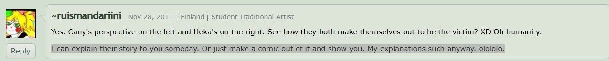 

That is, one can assume that she gives a choice to a person (Avencherus), where one of the choices is much more difficult in terms of implementation for her, says that she actually explains poorly, but draws well enough to explain everything better artistically. This opinion is also confirmed by the description under the painting "[re-crap](https://web.archive.org/web/20120403124723/http:/ruismandariini.deviantart.com/art/re-crap-257060378)"

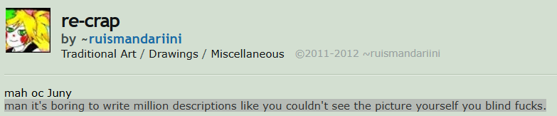> 

That is, Nemlei finds it very difficult to write descriptions, and, consequently, to write any texts, however, it is worth clarifying that these messages were written by her back in 2012, 14 years have passed, which is more than the age of some fans of the game. What can we say about the prospects for self-development? 

Judging by the [kattiapina](https://web.archive.org/web/20151023031657/http:/kattiapina.deviantart.com/) (Yolala) account, which was kept from 2014 to 2018, approximately, it is impossible to give exact indications, no artistic texts or even long messages were found. However, judging by the descriptions in the comments under the paintings "[Kisu Is A Cat](https://web.archive.org/web/20151023031657mp_/http:/kattiapina.deviantart.com/art/Kisu-Is-A-Cat-510209228?q=gallery%3Akattiapina%2F52043392&qo=10)" and "[god doesn't care](https://web.archive.org/web/20151023031657mp_/http:/kattiapina.deviantart.com/art/god-doesn-t-care-548531416?q=gallery%3Akattiapina%2F52043392&qo=8)", the quality of her texts has grown, but still she began to write full-fledged large artistic texts only in 2019 with the release of the first visual novel "Jack In A Castle", one can fully trace Nemlei's writing path. 

And now begins a brief literary review of a random set of visual novels released by Nemlei before TCOAAL, from a person who has nothing to do with literature at all, but strives for it. First of all, it is worth noting the characteristic features of Nemlei as a writer. What I called the four horsemen of the apocalypse of Nemlei, namely "Anyway", added when Kattiapina does not know how to start a phrase or dialogue, occurs everywhere in place and out of place. "......" --- many dots that seem to mean silence, can be repeated in dialogue up to five times, and "Sigh" --- these two horsemen essentially perform one function, filling in uninvented dialogues, and interestingly, the closer the finale of the game, the more dots and sighs, and the last horseman is rare foreign words with a very narrow meaning, as a rule, some characteristic of a character or something similar, because of which the texts of the games become many times harder to translate. 

Otherwise, Kattiapina's text and language are normal, although sometimes there are frankly graphomaniac turns in it like: "she knocked on the door so persistently as if she was supposed to get a prize for it" from "Better Half". Now it is worth telling about another feature of Nemlei. These are, as I called them, "Ashley-like" characters: there is one such character in every visual novel by Nemlei, all of them can be described as annoying and sarcastic, sometimes as manipulative. They are called Ashley-like because their level of elaboration, presented in the game at least, is in many ways inferior to Ashley. In Jack In A Castle it is Bunny Rabbit, in Better Half it is Tel, in No good Noelle it is Yul. For the sake of brevity, I will not analyze each character separately, and it is not necessary, since they are all similar. This line of characters is primarily due to Nemlei's rule, which she told in "[Questions & Answers](https://store.steampowered.com/news/app/2378900/view/503940938959160270)":

 "If I'm not entertained by at least some aspect of a character, I don't write them..."

However, what still contributed to the fact that Ashley, even if you cross out all information about Ashley except episode 1, is head and shoulders above her counterparts? In my opinion, several aspects play a role here, one of them is that Ashley has a prototype or, if you like, a great-grandfather in the person of such a character as Hekka. This character is a record holder for survivability: so, the first art with him dates from September 6, 2011 "[re-crap](https://web.archive.org/web/20120407133240/http:/ruismandariini.deviantart.com/art/re-crap-257060228)", and the last --- June 23, 2015 "[god doesn't care](https://web.archive.org/web/20151023142026/http:/kattiapina.deviantart.com/art/god-doesn-t-care-548531416)" on the [kattiapina](https://web.archive.org/web/20151023031657/http:/kattiapina.deviantart.com/) (Yolala) account, by the way. 

More art with him has come down to us than anything else, arranged in chronological order of appearance: "[re-crap](https://web.archive.org/web/20120407133240/http:/ruismandariini.deviantart.com/art/re-crap-257060228)", "[VICTORYYYY](https://web.archive.org/web/20120529110241mp_/http:/ruismandariini.deviantart.com/art/VICTORYYYY-282022414?q=gallery%3Aruismandariini%2F25034697&qo=4)", "[points of view](https://web.archive.org/web/20120327221038/http:/ruismandariini.deviantart.com/art/points-of-view-270982696)", "[hobbies](https://web.archive.org/web/20120529110241mp_/http:/ruismandariini.deviantart.com/art/hobbies-292444844?q=gallery%3Aruismandariini%2F25034697&qo=1)" and "[god doesn't care](https://web.archive.org/web/20151023142026/http:/kattiapina.deviantart.com/art/god-doesn-t-care-548531416)". 

Hekka is a deceitful and manipulative character, judging by the messages under "[re-crap](https://web.archive.org/web/20120407133240/http:/ruismandariini.deviantart.com/art/re-crap-257060228)", where she writes that this character can pretend to be good in order to manipulate someone, also being in a codependent relationship with a certain Kani, about whom there is no information at all; such a conclusion can be made from the description of the painting "[points of view](https://web.archive.org/web/20120327221038/http:/ruismandariini.deviantart.com/art/points-of-view-270982696)". And his story ends, as Nemlei wrote under the post "[god doesn't care](https://web.archive.org/web/20151023142026/http:/kattiapina.deviantart.com/art/god-doesn-t-care-548531416)", with the creation of his own cult with himself at the head. 

Therefore, I personally believe that Ashley, and maybe Andrew, has a background of another character, and therefore Ashley's image turned out so alive, however, this is far from the only reason.

**Nemlei's interests** 
Before starting, it should be clarified that interests are things that can change over a long period of time, so what interested Yolala or Avencherus in 2015 could have lost meaning for them ten years later. On the [kattiapina](https://web.archive.org/web/20151023031657/http:/kattiapina.deviantart.com/) (Yolala) account in the "journal" section you can find out what music Nemlei listens to: mainly rock, including Finnish, but rock is not limited to that. 

In the description under the painting "[Knock Out Gimmi Gimmi](https://web.archive.org/web/20151203001456/http:/kattiapina.deviantart.com/art/Knock-Out-Gimmi-Gimmi-513665388)" there is a working link to one of Nemlei's favorite songs (at the time of 2015) --- honestly, I was disappointed, it's cheap pop. On the same account she also wrote about her passion for comics, although this could have been understood earlier: so, under the work "[points of view](https://web.archive.org/web/20120327221038/http:/ruismandariini.deviantart.com/art/points-of-view-270982696)" she wrote that it would be convenient for her to explain everything with a comic. 

However, all this pales before her main passion, which, apparently, goes with her through life --- it's a mad love for cats. Probably this is the first thing you will notice if you go to any Nemlei account: on all accounts she has many paintings dedicated to cats. So, on [ruismandariini](https://web.archive.org/web/20100723043735/http:/ruismandariini.deviantart.com/) under the painting "[how is the view down there](https://web.archive.org/web/20120327202122/http:/ruismandariini.deviantart.com/art/how-is-the-view-down-there-266149608)" she writes that if there is something unclear in the image, then it is most likely a cat. On the [kattiapina](https://web.archive.org/web/20151023031657/http:/kattiapina.deviantart.com/) (Yolala) account more than half of the works are images of cats, even the avatar there is a cat. And the first game by Nemlei (which we will talk about in the block about Avencherus) was about cats.

**Conclusion**
The first thing to say: Kattiapina at the time of creating "The Coffin of Andy and Leyley" was already a formed personality with a lot of life experience behind her, including having been married for many years, which explains the game's clear negative position towards the heroes of its own story. Which is rare for this kind of game, and for games in general these days. Also, the existence of a brother explains why the relationship between brother and sister is so well conveyed in the game (however ambiguous that may sound).

The love for guro explains all this cruelty in the game (remember at least the gameplay part where we had to get rid of the parents' bodies). And the love for comics explains these, as it were, comic-styled inserts. Also, the nationality of the husband involved in development directly explains the Americanization of the game and characters, but his influence is not limited to this, as discussed in the next section.
Also, the success of the game becomes more understandable, since it is in TCOAAL that Nemlei as the main writer began to draw more, since it was in this game that these comic inserts first appeared, which freed Nemlei from writing any actions, since she draws much better than she writes.

Also in the game there is one detail that is not spoken about at all, like the rabbits, by the way. Ashley has been drawing since early childhood, like Nemlei, which can be understood from this interview "[Were talking crash here](https://web.archive.org/web/20120305012228/http:/sharpteethterrors.deviantart.com/journal/Were-talking-crash-here-261016848)", however, due to the fact that Ashley received no criticism, but only praise (remember the moment in the car from episode 3), she did not progress in any way and therefore at 20 years old she draws just as badly, unlike Nemlei. Since in 2010 on [ruismandariini](https://web.archive.org/web/20100723043735/http:/ruismandariini.deviantart.com/) in the "About me" section she said that one of her goals of being on DeviantArt is to "become a better artist", that is, to improve herself as an author. And finally, I will quote Nemlei's own words about herself, written in 2010 in the "About me" section, when she was 18 years old:
     
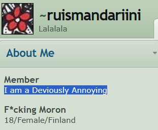 

Agree, this description fits Ashley's image well, if not perfectly. In my opinion, these facts, if they do not say that Ashley is Nemlei's doppelganger, then at least confirm the opinion that Mandarin, when creating this character, was partly, and maybe primarily, inspired by herself in her teenage years.

However, it still remains unclear: why did the developers go into full isolation, because Nemlei was never an introvert even close, and it doesn't seem that she was, on the contrary, the same Nemlei on her two accounts was constantly written to how wonderfully she draws. Avencherus's comments on two accounts, though few, also do not contain harassment, so I think the version with harassment can be removed, since most likely 
Nemlei, as a person who has been on the internet for many years and leading a full-fledged creative activity there, would hardly leave it after the first failures.

It is also still unclear where in TCOAAL the coherent and well-thought-out storyline with "Toxisoda" and criticism of modern media came from, if Nemlei is not interested in the problems of modern society.

HOORAY

Agree, this description fits Ashley's image well, if not perfectly. In my opinion, these facts, if they do not say that Ashley is Nemlei's doppelganger, then at least confirm the opinion that Mandarin, when creating this character, was partly, and maybe primarily, inspired by herself in her teenage years.

However, it still remains unclear: why did the developers go into full isolation, because Nemlei was never an introvert even close, and it doesn't seem that she was, on the contrary, the same Nemlei on her two accounts was constantly written to how wonderfully she draws. Avencherus's comments on two accounts, though few, also do not contain harassment, so I think the version with harassment can be removed, since most likely 
Nemlei, as a person who has been on the internet for many years and leading a full-fledged creative activity there, would hardly leave it after the first failures.

It is also still unclear where in TCOAAL the coherent and well-thought-out storyline with "Toxisoda" and criticism of modern media came from, if Nemlei is not interested in the problems of modern society.

# Chapter 5 Avencherus.

**Avencherus and openness** Tumblr and Twitter are indicated, he also indicates in the account description his favorite artist --- Bob Ross. Also in the comments under his work "[The Kisuverse Begins](https://web.archive.org/web/20151031202819/http:/avencherus.deviantart.com/art/The-Kisuverse-Begins-559251536)" he openly speaks about his wife's nationality, he also ran his own group there. But on the first account [Shisho2k](https://web.archive.org/web/20110324184928/http:/shisho2k.deviantart.com/). He is much more frank: so, on this account there is a section "Devious Info", in which he reveals his favorite films, music, favorite writers and other things we will talk about later.

**Shisho2k and Avencherus are the same person** It is also worth explaining why the accounts [Shisho2k](https://web.archive.org/web/20110515040544/http:/shisho2k.deviantart.com/) and [Avencherus](https://web.archive.org/web/20150905232045/http:/avencherus.deviantart.com/) are accounts of one person, because at first glance it doesn't look like it: on [Shisho2k](https://web.archive.org/web/20110515040544/http:/shisho2k.deviantart.com/) the person is mainly engaged in drawing with graphite pencils and pens, judging by the information from the "Devious Info" section --- "Tools of the Trade: Graphite Pencils and Pape", while [Avencherus](https://web.archive.org/web/20150905232045/http:/avencherus.deviantart.com/) is engaged exclusively in photography. 

However, if you look at the [Shisho2k](https://web.archive.org/web/20110324184928/http:/shisho2k.deviantart.com/) profile for March 24, 2011, a diary entry "Winning Art Trade" immediately catches your eye, where he rejoices at exchanging paintings with [ruismandariini](https://web.archive.org/web/20120529110241/http:/ruismandariini.deviantart.com/), where he receives from her the painting "Bonus: Animated acid cloud.", and if you open the [Avencherus](https://web.archive.org/web/20160601034105/http:/avencherus.deviantart.com/) account for June 1, 2016 and read the comments section at the very beginning, you can find a comment left by [Yolala](https://web.archive.org/web/20150907030134/http:/kattiapina.deviantart.com/), where she sends him a painting, in response to which [Avencherus](https://web.archive.org/web/20160601034105/http:/avencherus.deviantart.com/) sends "Bonus: Animated acid cloud." with the words "Iconic icons." 

Also [Shisho2k](https://web.archive.org/web/20110324184928/http:/shisho2k.deviantart.com/) mentioned in the "Devious Info" section that he loves playing guitar: "Interests: Music (mainly guitar)", and on the [Avencherus](https://web.archive.org/web/20150905232045/http:/avencherus.deviantart.com/) account there is a post "[Tension](https://web.archive.org/web/20150920220348/http:/avencherus.deviantart.com/art/Tension-560659576)", in which the guitar is mentioned. And thus one can understand that this is the same person.
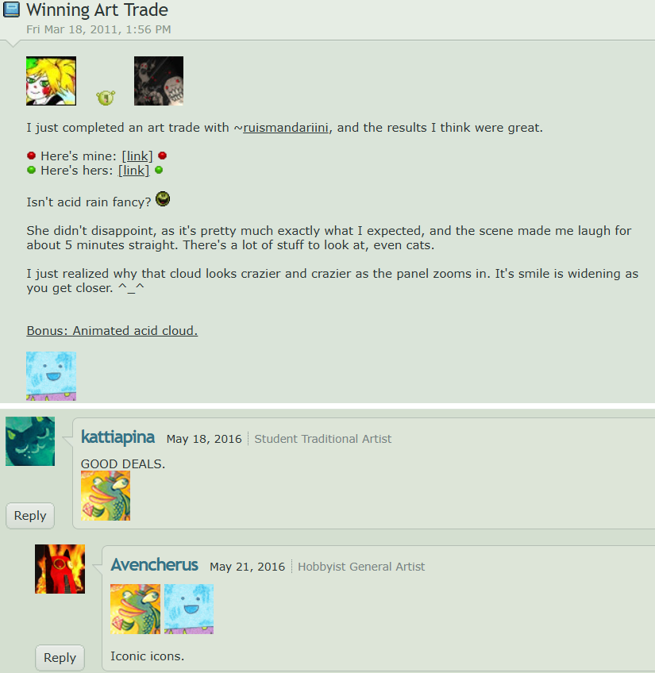

**Avencherus's hobbies** As we already know, he is an American who moved to Finland sometime before 2014. Judging by the [Shisho2k](https://web.archive.org/web/20110324184928/http:/shisho2k.deviantart.com/) account, at the beginning of his creative path he drew exclusively with graphite pencils, but this was not his main occupation, for example, in the ["About me"](https://web.archive.org/web/20110324184928/http:/shisho2k.deviantart.com/) section he openly writes that he is a software developer, which is confirmed by the diary entry from November 7, 2012 "[My Game Map](https://web.archive.org/web/20121107053523/http:/shisho2k.deviantart.com/)", in which he talks about a map he created for an online game, but already on the [Avencherus](https://web.archive.org/web/20150905232045/http:/avencherus.deviantart.com/) account he publishes only photographs taken with macro photography, for example, on his account you can find many paintings, for example "[Fading Blue Crystal](https://web.archive.org/web/20150912034936/http:/avencherus.deviantart.com/art/Fading-Blue-Crystal-558393332)", from the descriptions under his photographs one can understand that most of them are dedicated to nature. 

Also Avencherus has the same love for cats as Nemlei: so, half of his photographs in the gallery depict cats, also on his account there is a separate collection "Spectacular Cat Gallery" which contains more than 200 images of cats. As on his avatar something cat-like is depicted, besides all joint works with Kattiapina were dedicated to cats, for example, "[Night of the Ghost Cats](https://web.archive.org/web/20151025200353/http:/avencherus.deviantart.com/art/Night-of-the-Ghost-Cats-552101294)", which is surprising, since on the [Shisho2k](https://web.archive.org/web/20110515040544/http:/shisho2k.deviantart.com/) account there are no hints at all of love for cats, so apparently he adopted it from Nemlei. 

From what has been said, one can conclude that Avencherus, due to his profession, has a very indirect relation to art, which, however, does not prevent him from actively expressing himself either through drawing, or through photography, or even literature, for example, he has one story "[Afraid to Look Back](https://web.archive.org/web/20110515040544mp_/http:/shisho2k.deviantart.com/art/Afraid-to-Look-Back-206912871?q=gallery%3Ashisho2k&qo=2)", which speaks of Avencherus's active creative search in the period from 2010--2015, but their result, unfortunately, cannot be known, however, one can assume that he came to self-expression in the form of creating video games.

**Why Avencherus still works with Nemlei** As we remember from the description of Nemlei's account on "[itch.io](https://web.archive.org/web/20190716192015/https:/nemlei.itch.io/)" since 2019 she works alone.

  "I make visual novels all by myself"

Which can clearly be interpreted as Avencherus no longer participating in the creative process, and this may indeed seem so, because there are no direct arguments that Avencherus still works on games. However, if you perceive this phrase critically. In this coherent picture of a solo developer, cracks begin to appear. The first of which is that Nemlei was never fond of programming, since there is not a single mention of it in the documents, not even indirect. 

Second: even if we assume that Nemlei was taught programming by Avencherus since 2014, that is three years, given the fact that Nemlei was still studying and most likely working in her specialty, if you read the description of the painting "[Soft Dreams](https://web.archive.org/web/20151209074533/http:/kattiapina.deviantart.com/art/Soft-Dreams-529551261)", like Avencherus, most likely could hardly understand anything beyond the basics. Therefore, from 2019 to 2022 she released 5 games, that is, 1.5 games per year, which is a lot for a beginner working alone, and moreover, two of which "Jack In A Castle" and "Better Half" in duration with all endings, given that in the latter there are only four, equals in my feelings approximately 7--8 hours, given that the game also has a good graphical component, albeit simple. 

Therefore, I believe that a solo beginner cannot maintain such a brisk pace of releasing games and their quality, unless, of course, someone helps her, for example, Avencherus, because there are simply no other options. However, why did she say that she works alone? Is she lying? Well, given the fairly simple structure of the games before TCOAAL, judging at least by the same menu structure, where textures were simply changed from time to time. For Avencherus with many years of programming experience, this was something on the level of taking out the trash in the morning. Thus, the theory I put forward about the separation of these two people is refuted, and thus the only version of why they went into isolation remains a strategic calculation.

**Avencherus and world culture**Such an opinion may arise as a logical development of the theory about the similarity of the character Ashley and Nemlei, and at first glance it may indeed seem so, because the following entry in the diary of [Avencherus](https://web.archive.org/web/20130401091907/http:/shisho2k.deviantart.com/) "Random Thoughts #1 - Infinity and the Universe"

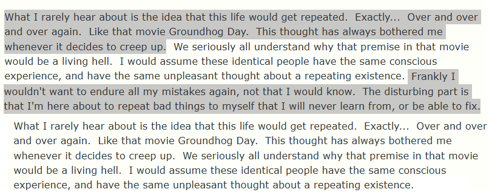

Which can be interpreted as pessimism and dissatisfaction with one's life.

And if you read another diary entry "[Random Thoughts #3 - Democracy](https://web.archive.org/web/20130727195846/http:/shisho2k.deviantart.com/)", where he reflects on the impossibility of democracy due to human ignorance

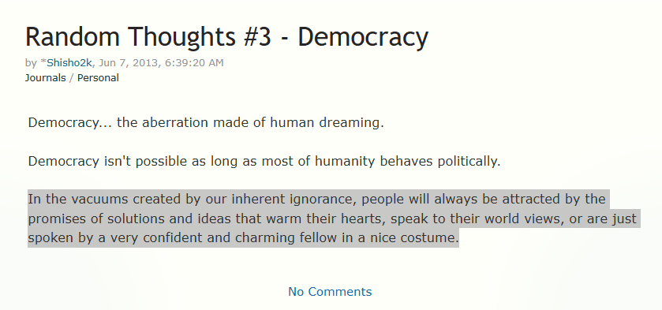

Such a view of the situation can be interpreted as cynicism, which is also inherent in the character Andrew.

And if you dig really deep, then based on the entry "[Random Thoughts #2 - Arrogance](https://web.archive.org/web/20130414161005/http:/shisho2k.deviantart.com/)", where he says that being arrogant is great in the sense that you possess an unlimited supply of feigned confidence.

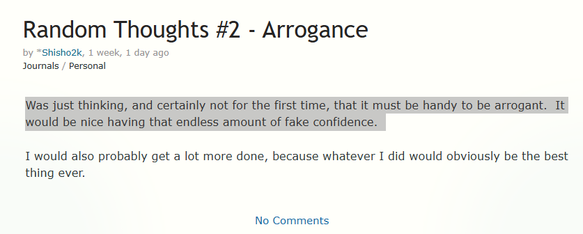

Also in the entry "[Random Thoughts #3 - Democracy](https://web.archive.org/web/20130727195846/http:/shisho2k.deviantart.com/)" he also mentions confidence as a factor to control people

> "people will always be attracted by the promises of solutions and ideas that warm their hearts, speak to their world views, or are just spoken by a very confident and charming fellow in a nice costume."

And such frequent mention of "confidence" may indicate that Avencherus may lack it, as well as the character Andrew, however, in the end, in my opinion, relying only on diary entries written more than 10 years ago, making such far-reaching conclusions is premature, however, I still believe that in any case I do not consider him the sole prototype of Andrew on the grounds that Nemlei, despite all the criticism expressed in her direction, in my opinion, really has too good an imagination to simply copy the characters of the heroes from her immediate environment with minimal changes. I am inclined to believe that the answer to this question is rather no than yes.

**Avencherus — secret writer of TCOAAL!?**

Surprise

As already mentioned earlier, his creative searches also included writing, although these searches include one story "[Afraid to Look Back] (https://web.archive.org/web/20110515040544mp_/http://shisho2k.deviantart.com/art/Afraid-to-Look-Back-206912871?q=gallery%3Ashisho2k&qo=2)". However, this does not negate the fact that this person is inclined to write large essays-reflections, for example the diary entry on the account "Random Thoughts #1 - Infinity and the Universe", but especially how much more Avencherus writes can be understood by comparing entries with similar content on [Shisho2k](https://web.archive.org/web/20130330054358/http://shisho2k.deviantart.com/) from July 7, 2012 "[Get Featured](https://web.archive.org/web/20120707010956/http://shisho2k.deviantart.com/journal/Get-Featured-286732190)" and on the [ruismandariini](https://web.archive.org/web/20130215040637/http://ruismandariini.deviantart.com/) account from December 1, 2012 "[CONTEST WINNERS~](https://web.archive.org/web/20130215040637/http://ruismandariini.deviantart.com/journal/CONTEST-WINNERS-340672701)".

Therefore, it is logical to assume that maybe the game's community was looking in the wrong place and all this time the author of the plot of all games was Avencherus, and Nemlei was just an artist? However, as I said, information from these sources should be perceived with the condition that it is very outdated, and over these 14 years, six of which Nemlei has been actively writing for 6 years, she could have simply learned, which she did. So already in Better Half there is much less "......" and "Anyway", what can we say about TCOAAL. Also, in general, the text itself with its speech patterns resembles Nemlei's speech rather than Avencherus's; in order not to stretch the chapter into a multi-page lecture on the peculiarities of language, I recommend, to check my words, to read this diary entry of Avencherus "Random Thoughts #1 - Infinity and the Universe", and then compare the manner of presentation of the text with the text, for example, of episode 1 of TCOAAL or in "No good Noelle", because it is short.

# Conclusion
Now it is worth summing up. First of all, it is worth noting that Avencherus in terms of the scale of his personality, in my opinion, is not inferior to Nemlei, and in some aspects even surpasses her. So, being not as sociable a person as Nemlei, he at the time when Kattiapina was just studying, he already had the specialty of a programmer, which suggests that Avencherus is at least three years older than Nemlei. Also, thanks to his skills, we can play all these games, including TCOAAL, since he is still responsible for its technical component. However, this does not mean that his influence on Nemlei's creativity does not go beyond the technical component.

Even despite the fact that he has no direct relation to writing the text, this does not mean that there is no influence on the game. At this point it is worth returning back to the conclusions of chapter 4, where I among other things said:

> "It is also unclear where in TCOAAL the coherent and well-thought-out storyline with the company "Toxisoda" and criticism of modern media came from, if Nemlei is not interested in the problems of modern society."

However, the problems of modern society are very interesting to Avencherus, as we found out, moreover, if you open the works of one of Avencherus's favorite writers --- Noam Chomsky, and more specifically "Profit Over People" and "Manufacturing Consent". Don't grab your heads, I will not analyze them in detail in order not to lengthen the work even more and because I don't have that much time to delve into them in detail. 

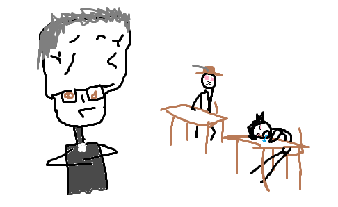

Therefore, I will go over the tops. So, in the annotation of the book "Profit Over People" it is written the following:

> "... Chomsky criticizes the tyranny of the few, which limits public space and pursues policies that multiply private wealth, often with complete disregard for social and environmental consequences"

Particularly interesting is the mention of disregard for the environment, remember the newspaper in the killer's car, where cleanup after chemical contamination of the city is mentioned. But much more important is another thing: so, Chomsky's main idea in the book comes down to criticism of neoliberalism as a model of society in which profit is put at the forefront to the detriment of ordinary citizens:

> "If we ask ourselves why there is ever-growing inequality between rich and poor, the decline of the middle class and the plundering of our social fabric, the reason is that profit is put above people. This is class war, and the public good is being plundered, and our societies are being emptied." --- as stated in the summary of the book.

A grotesque visualization of which we see in the first episode, where a corporation for profit dooms hundreds, and maybe thousands of people to starvation, locking them in their homes. Also, one of the central ideas of the book is criticism of the gradual transfer of control over society into the hands of corporations and thus undermining democracy.

And in the game this is shown through a water supply company that has replaced the functions of the state and belongs to the mega-corporation "Toxisoda"; in addition, the same idea is shown through the media, about which Chomsky writes in more detail in "Manufacturing Consent". In this work, Chomsky derives the theory "Propaganda Model" --- this is a theory that explains why news in major media often sounds the same and reflects the interests of power, and not objective reality; according to this theory, this happens because:

> "In essence, private media are large corporations selling a product (readers and audience) to other companies (advertisers)"

Which is what we see in the news in the first episode, where in between endless ads for Toxisoda they show news safe for the authorities about the opening of a new art exhibition.

One could actually go on for a long time, so I will lead to the fact that in the first two episodes Chomsky's ideas are presented extremely straightforwardly and caricatured. The corporation "Toxisoda" is not subtle satire, but rather grotesque. This does not look like the style of a person who is really deeply immersed in political philosophy. Rather, it looks like the author himself is just getting acquainted with the idea and transfers it to the game in the most general form.

This led me to think that the anti-corporate line was written by Nemlei, but not by herself --- but under the influence of Avencherus. He could have suggested the idea to her, given her Chomsky to read, discussed it with her. But the implementation is her work. In the third episode, this line becomes more complex and deeper, which may indicate that Nemlei either understood the topic better, or Avencherus began to participate more actively in writing. Either way, the political layer of TCOAAL is the result of their joint work, and not someone's sole contribution in my opinion.

# Summary

Approaching the end of this titanic work for me personally, it is worth summing up the final result on the two main directions of research in this work, namely the internal state of Kit9studio. And also the interpretation of some moments directly in the game itself.

First of all, it is worth drawing a line under Kit9studio. This is a studio founded back in 2018 for releasing games by a married couple, where the husband (Avencherus) was engaged in programming, and the wife (Kattiapina) as the main artist and writer. However, already two years later they realized that Nemlei in any case cannot simultaneously run social networks and fully manage development, so they decided to change tactics from maximum openness and full feedback with players to maximum concentration on game development and almost complete detachment from the community. 

However, with the release of TCOOAL, the distribution of responsibilities shifted somewhat, and Avencherus began to occupy much more importance in the creative process. If from the period of 2019 he was very secondary, because visual novels do not require any special programming skills, since the main emphasis there is on groaning and visuals, which Nemlei was engaged in, but already during the development of TCOOAL he began to play a much larger role, since the game became more complex both in terms of code and in terms of plot, in which pressing social problems began to be raised, which had not interested the developer before, and the shortest and most likely way how Nemlei could become interested in this is Avencherus, who was interested in exactly such topics since the beginning of the 10s.

Now about the developers themselves. Nemlei is a Finnish artist who studied from 2010 to 2014. At the same time, she actively maintained many accounts on various social networks, where she shared her creativity and found a fairly large response among the audience, including Avencherus. After finishing her studies, she married him sometime in 2015. From this moment the history of Kit9studio can be dated.

Avencherus is an American programmer who, by all appearances, is older than Nemlei. Besides his main activity, he is interested in music, drawing, and modern philosophy. He met Nemlei in 2011, and this communication ended with him moving to Finland to Nemlei for permanent residence sometime in 2014. Despite his numerous talents, apparently in the studio before TCOAAL he acted as a programmer and, possibly, a co-author on matters in which Nemlei was unsure.

Also, as a result of analyzing the personalities of the developers, I came to the conclusion that the success of TCOOAL is not an accident, but a regularity of correctly used strengths of the developers. In total, I identify three reasons for success. 

The first is a successful basis for the story, the plot of a duet of two opposites is itself far from a new phenomenon, even in the same "Lord of the Rings" there is a duet of the refined and sublime Legolas and the rough and earthy Gimli. However, the duet invented by Nemlei is unique in that it consists of non-humans, each of whom has absolutely no justification, and surprisingly it is very entertaining to watch. 

The second is the addition of full-fledged gameplay, which such characters needed, since committing all sorts of villainies directly, and not through dialogue lines, only helps immersion in the characters' story, therefore in my opinion, despite all the achievements of episode 3 in revealing and deepening the character of Andrew, he still could not surpass in my opinion episodes 1 and 2 because in episode 3 the gameplay is mostly torn from the narrative, because of which it is perceived as a gate between plot blocks, and not gameplay flowing from dialogues. 

And the third, as I formulated it, "draw, don't tell"; by this concept I mean that Nemlei has always been better at drawing than writing, no, this is not to say that Nemlei is a graphomaniac, no, far from it, but also not Dostoevsky with Saltykov-Shchedrin. She in my humble opinion is average, striving for better and actively progressing. However, I note that at least the moment with the quarrel in apartment 302 would not be half as memorable without the visuals.

Also at the end I will clarify that everything said is just the most probable, in my opinion, theory, and no one forbids you to believe in other theories and hypotheses put forward by me, even if I refuted them, maybe it is you who will be able to rehabilitate them?

Also, in this work far from everything was mentioned, there are still moments that could pull on a couple more small works, also in the work I did not take into account information from [Itch.io](https://itch.io/) from the comments section of Nemlei, which, by the way, is quite well and fully preserved. I did not take this information into account because I simply learned about its existence already at the time of writing this final conclusion, and by that moment I had completely rewritten the work already 3 times (sorry, I'm fucking tired), however, the initial analysis showed that the information does not radically not overturn my conclusions. However, the analysis is only an initial analysis, and who knows what other riddles and mysteries, or maybe answers to questions, are hidden by "[Itch.io](https://itch.io/)".

**And that's actually all!**
